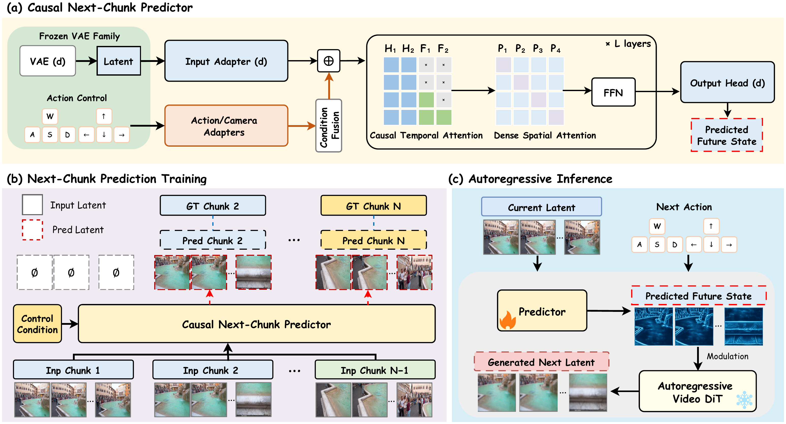

# FutureWorld: A Plug-and-Play Causal Next-State Predictor for Interactive Video World Exploration

**[Project Page](https://GuangYuanKK.github.io/futureworld)**

## Authors

Guangyuan Li1,2 · Kelu Yao3,&#42; · Shuolin Xu4 · Xinlei Yu2 · Wei Xing1 · Lei Zhao1,&#42; · Peng-Tao Jiang5 · Xiaogang Xu1 · Xiaobin Hu2,&#42;

1Zhejiang University · 2National University of Singapore · 3Zhejiang Lab · 4Bournemouth University · 5vivo BlueImage

\*Corresponding authors

## Abstract

Interactive video world models aim to follow user actions while maintaining scene consistency over extended interactions. History-based methods reuse generated latents to preserve scene content, but three limitations of this reuse contribute to error recirculation. (1) The latent generated at each interaction is retained as history, potentially containing blurred details, geometric distortions, or semantic drift. (2) Although retrieved historical content matches the current scene, it can still contain errors that are carried into the next chunk. (3) New outputs then become history for later interactions, potentially reinforcing the same errors through repeated reuse.

To limit this cycle, we predict the future scene state from the current generated latent and the next action before generating the next interaction’s video chunk. This future-state prior guides the next chunk, with the aim of reducing the errors carried forward from history. We propose a plug-and-play Causal Next-Chunk Predictor (C-NCP) with cross-model adaptability and prediction-guided modulation. C-NCP is integrated into four base generators and evaluated across three benchmarks for interactive long-video generation and action-conditioned world modeling. The experiments show reduced error accumulation and improved long-horizon consistency across generation settings.

## Model

  

